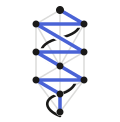

<p align="center">
  <picture>
    <source media="(prefers-color-scheme: dark)" srcset="docs/assets/lattice-mark-dark.svg">
    
  </picture>
</p>

# Lattice

The presentation layer over Idea Machine's idea lattice (`~/data/code/ideamachine`, ROADMAP §3.5 and Phase 2).
Idea Machine owns the truth and publishes it as views in schema `pub`. Lattice reads them as role `lattice_app`.
Its only write, from a later slice, will be appending to `pub.feedback_events`.

What it does (Idea Machine's ROADMAP, Phase 2 slices 2 and 5):

- **Review** with a light touch: five spot checks, picked across Idea Machine's confidence (one per band, by a hash
  of the id, so every device and the MCP server agree), to judge one by one, and **Keep the rest** in one tap.
  Those keeps carry `{"bulk": true}` so Idea Machine can weigh them below a verdict I read; anything I untick stays
  in the queue. Once the queue is empty, **Look again** brings back captures kept unread whose idea has since turned
  out to matter (I linked it, it evolves another idea or echoes the archive, it bridges themes, it came up in a
  comparison, or it was said again), for a real verdict; discards are the high-signal one while I keep by default.
  Or go **one by one**, with keep / ★ / discard and one-tap reasons. When the captures
  run out, **compare ideas** two at a time ("which is better?", `idea_compare` events): a steadier signal for Idea
  Machine's ranking than keep and discard. Idea Machine picks the pairs (`pub.compare_pairs`); without them,
  neighbouring scores or a shared theme. The order shown is random and recorded.
- **Map**: ideas laid out by meaning (`pub.idea_positions`, a 2D projection Idea Machine keeps stable), colored by
  theme, sized by weight (evidence, and a star counts for two), with connections. Tap an idea for its evidence:
  star it, correct it, link it to another idea, or keep / discard its captures in place. Tap a theme to see what
  it is and its ideas, best first, with Pin / Reject in view; the map zooms to them and dims the rest. A dashed ring marks ideas
  that are new since your last visit (the app was away for over half an hour).
- **Bridges**, a switch on the map: ideas that touch two or more themes (in several, or linked across) stay lit,
  with only the cross-theme links; the panel lists the strongest and what they connect.
- **Territories**, a switch on the map: the same places read as a map, each area colored by the theme of its
  nearest idea, with theme names where each theme is densest.
- **Time**: one row per idea, a dot for every time it came up; Recurring puts what keeps coming back first.
- **List** and search, best first once Idea Machine scores ideas (`pub.idea_scores`), with each idea's score and
  why in its panel.
- **Local-first.** The page carries no data. It renders a copy of `pub` kept in IndexedDB (`/api/snapshot`), and a
  service worker keeps the page itself, so the app opens and navigates offline. Feedback goes into a queue,
  applied to the copy at once and sent when the server can be reached; the copy is rebuilt from the server's
  snapshot plus whatever is still queued. Every sync replaces the copy whole, so what Idea Machine forgets is gone
  from the phone too. Logging out (in the run-status panel) clears the copy and the queue.

- **Talk to it (MCP).** `/mcp` is an MCP server (Streamable HTTP, JSON responses) over `pub`: `search_ideas`,
  `best_ideas`, `get_idea`, `list_themes`, `open_theme`, `whats_new`, `compare_pair`, `review_digest`, and, when you
  ask, `star_idea`, `link_ideas`, `note_idea`, `record_comparison`, `decide_item` (your verdict on a spot check) and
  `keep_rest` (the rest, in bulk), plus `look_again` (kept unread, now mattering; `whats_new` counts them). "Let's
  catch up on review" works by voice.
  It takes the Lattice token as a bearer header and is tailnet-only like the rest. For claude.ai and the phone
  app, which connect from Anthropic's cloud, see [docs/public-mcp.md](docs/public-mcp.md). Speakers are pseudonymized per answer ("me",
  "unknown", S1, S2...), as in Idea Machine's privacy policy B. From Claude Code on a tailnet machine:

  ```sh
  claude mcp add --transport http lattice https://<host>.ts.net:8444/mcp --header "Authorization: Bearer $LATTICE_TOKEN"
  ```

Every change is a feedback event, Lattice's only write (with `source` 'mcp' for changes made in conversation). Service workers need HTTPS or localhost, which `tailscale
serve` provides.

```sh
set -a; . ~/data/code/ideamachine/.env; set +a      # LATTICE_DATABASE_URL
uv run lattice serve                                # http://127.0.0.1:8790/
uv run pytest                                       # smoke tests against the real database (read-only)
```

Don't bind it to the LAN or the internet: evidence quotes include other people's words. The one exception is the
MCP endpoint alone, published for claude.ai and the phone app through a Cloudflare Tunnel, behind OAuth and
Anthropic's address range ([docs/public-mcp.md](docs/public-mcp.md)), and only if you set it up.

## Always on

`systemd/install.sh` runs `lattice serve` as a user service on localhost:8790. It reads `.env`, which holds only
`LATTICE_DATABASE_URL`, and the service restarts after code changes only when you restart it. The script then puts
it on the tailnet with `tailscale serve`, at https://eeyore.example.ts.net/ with Tailscale's certificate.
That step needs root once: `sudo tailscale serve --bg http://127.0.0.1:8790`, or `sudo tailscale set
--operator=$USER` to allow serve changes without root. Never `tailscale funnel`, which would publish it to the
internet.
